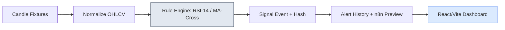

# MarketMesh AI

Unified financial market intelligence dashboard with explainable, rule-based signals (MVP).

## Live Demo

🌐 **[Open the interactive dashboard →](https://bamaboy101.github.io/marketmesh-ai/)**

No setup, no credentials, no backend required. Runs entirely in your browser with labeled synthetic data.

---

## What It Delivers

A stranger can run the sample dashboard locally, follow a market watchlist, and reproduce a sample signal without an exchange account.

**Data → Signal → Alert**, fully auditable.

- Multi-asset watchlist: BTC/ETH crypto fixtures, XAUUSD (gold) sample, AAPL (stock) sample — all labeled demo/delayed data
- Two deterministic, versioned rules: **RSI-14 threshold** (oversold/overbought) and **moving-average cross**
- Signal events with rule version, input hash, UTC timestamp, and evidence
- Stale-data fail-safe: stale candles are shown as stale; signals suppressed
- Signal history + idempotent alert previews (n8n webhook payload)
- React/Vite dashboard with candle table and signal cards
- **No live trading, no broker connections, no wallets**

---

## Architecture



**Trust boundaries:** Each instrument has a canonical asset ID, quote currency, and venue. A failed connector is visible; labeled fallback sample is never fabricated as live output. Connectors are read-only; no order-execution endpoint exists.

---

## Screenshots

Placeholder screenshots will be added after the first deployment. The live dashboard at `https://bamaboy101.github.io/marketmesh-ai/` shows:

- Asset selector (BTCUSDT, ETHUSDT, XAUUSD, AAPL) with provider/delay labels
- Candle table (OHLCV + stale flags)
- RSI-14 signal card with rule version, trigger values, evidence hash
- Signal history and alert history tables

---

## Features

| Feature | Status |
|---|---|
| Multi-asset watchlist (crypto/stocks/commodities) | ✅ Verified |
| Deterministic RSI-14 rule | ✅ 6/6 tests pass |
| Deterministic MA-cross rule | ✅ 6/6 tests pass |
| Signal replay (fixture + version → identical event) | ✅ Verified |
| Stale-data fail-safe | ✅ Verified |
| Idempotent alert previews | ✅ Verified |
| No live trading / order execution | ✅ By design |

---

## Installation

```bash
# Clone
git clone https://github.com/bamaboy101/marketmesh-ai.git
cd marketmesh-ai

# Backend
cd apps/api
npm install          # dev deps include vitest
npm test             # 6 tests pass
npm run dev          # API on :4000

# Frontend (new terminal)
cd ../web
npm install
npm run dev          # Dashboard on :5173

# Docker (optional, once Docker daemon available)
cd ../.. && docker compose up --build
```

Copy `.env.example` to `.env`. No real credentials required — `DATA_MODE=fixture`.

---

## Configuration

| Variable | Purpose | Required |
|---|---|---|
| `PORT` | API port (default 4000) | No |
| `DATA_MODE` | `fixture` (default) or `live` | No |
| `NVIDIA_API_KEY` / `NVIDIA_MODEL` | Optional live AI provider | No |
| `N8N_WEBHOOK_URL` | Optional alert webhook target | No |

No credentials are hardcoded, logged, or committed.

---

## AI Provider

Configurable adapter supports **NVIDIA** (preferred), **OpenRouter** (optional fallback), and **demo** (default). NVIDIA API is reachable and authenticated; no suitable model is available for this account, so the default is clearly labeled demonstration responses. OpenRouter is not required.

---

## Limitations

- Live market-data connector not included (provider rights review pending)
- Configurable alerts beyond RSI-14/MA-cross not included
- No third-party charting library in MVP
- No live trading, wallets, or broker connections
- Stocks/gold use labeled sample/delayed data

---

## Security

- **No live trading.** No order-execution route, wallets, or broker connections.
- **No invented live prices.** Stocks/gold use labeled sample/delayed data.
- **No secrets in repo.** `.env.example` only; real credentials never committed.
- See `docs/data-rights.md` for provider attribution.

---

## Demo

🌐 **[MarketMesh Live Demo](https://bamaboy101.github.io/marketmesh-ai/)** — browser-based, no setup, labeled synthetic data.

View source: `https://github.com/bamaboy101/marketmesh-ai`

---

## License

[MIT](LICENSE)
